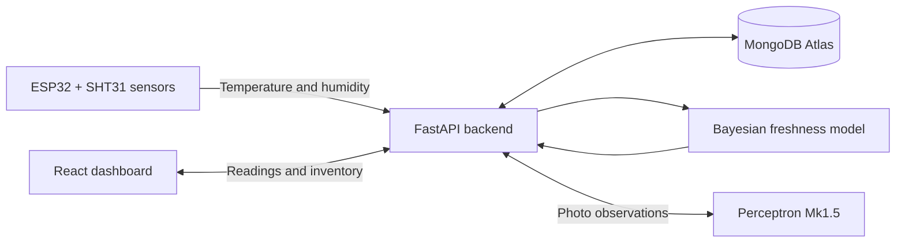

# ShelfLife

**Know what your food has been through—not just the temperature right now.**

Built at **DubHacks 2026**, ShelfLife pairs ESP32 sensors with a food inventory and a Bayesian freshness model to help reduce food waste. It combines storage conditions, printed dates, and freshness checks to estimate what to use first.

[Run the demo](#run-the-demo) · [Connect hardware](HARDWARE.md) · [Explore the model](backend/risk/HOW_IT_WORKS.md) · [Meet the team](#team)

## Why ShelfLife?

A fridge reading 38°F right now tells you nothing about the two hours it spent at 50°F overnight. ShelfLife keeps that history and evaluates it for each food item, so a brief door opening and a long warm spell lead to different recommendations.

## What it does

- **Monitors real storage conditions.** ESP32 nodes with SHT31 sensors report temperature and humidity across fridge zones.
- **Estimates freshness over time.** A Bayesian model combines food-specific storage profiles, printed dates, sensor exposure, and photo or manual observations. Results include estimated time remaining, a likely range, and the estimated chance an item is past its best.
- **Logs food from photos.** Perceptron Mk1.5 suggests food names, categories, packaging, visible freshness, and printed dates. Review and edit suggestions before saving.
- **Tracks changes.** Re-log an item with a new photo to compare its appearance and see its freshness history.
- **Makes the next action clear.** Dashboard, Inventory, Sensors, and Alerts pages surface what needs attention. Mark food as used or tossed to track outcomes.
- **Stores data in MongoDB Atlas.** Inventory, photos, freshness checks, and sensor readings use Atlas through PyMongo when configured. Simulated sensors support demos without hardware.

## How it works



1. Sensors post readings to the backend, which stores them by fridge zone.
2. Users log food with a photo or manual entry, including its zone, packaging, and printed date when available.
3. The model combines the item's history and observations into a freshness estimate with uncertainty.
4. The dashboard shows conditions, trends, estimates, and recommendations. Estimates continue refreshing when sensors stop, using the model's treatment of unobserved time.

The dashboard loads full-day sensor history in batches and summarizes readings into one-minute averages for scoring. Raw readings remain available for live status, charts, and door events when supplied by the data source.

### The freshness model

The model uses published temperature-dependent deterioration models and water-loss calculations, then updates its estimates from each item's own freshness checks. It is a probabilistic model rather than a classifier trained on labeled household spoilage outcomes.

Supported profiles: **raw poultry, milk, leafy greens, strawberries, whole produce, and other refrigerated food**. The last two are broad estimated fallbacks; use a specific profile when one fits.

Read [how the model works](backend/risk/HOW_IT_WORKS.md) for assumptions, sources, and limitations.

## Hackathon MVP

- [x] Working ESP32 temperature and humidity sensors
- [x] Live dashboard with Dashboard, Inventory, Sensors, and Alerts pages
- [x] Food-specific profiles and historical exposure tracking
- [x] Bayesian freshness estimates with remaining-life ranges and uncertainty
- [x] Photo-assisted inventory logging and freshness re-checks
- [x] MongoDB Atlas integration for inventory, photos, freshness checks, and sensor history
- [x] Live cooler demonstration

## Run the demo

You need **Python 3.10+**, **Node.js 18+**, and npm. Run the backend and frontend in separate terminals. Hardware and a Perceptron key are optional for manual inventory entry and simulated sensor data.

### 1. Start the backend

From the repository root:

**macOS / Linux**

```bash
cd backend
python3 -m venv .venv
source .venv/bin/activate
python -m pip install -r requirements.txt
cp .env.example .env
python -m uvicorn main:app --reload
```

**Windows PowerShell**

```powershell
cd backend
python -m venv .venv
.\.venv\Scripts\python.exe -m pip install -r requirements.txt
Copy-Item .env.example .env
.\.venv\Scripts\python.exe -m uvicorn main:app --reload
```

Copy `.env.example` only on first setup; preserve an existing `.env`. To use MongoDB, configure the [Atlas settings below](#mongodb-atlas) before starting the backend. The backend listens on [localhost:8000](http://localhost:8000). Interactive API documentation is at [localhost:8000/docs](http://localhost:8000/docs).

### 2. Start the frontend

In a second terminal, from the repository root:

```bash
cd frontend
npm ci
npm run dev
```

Open **[the simulated demo](http://localhost:5173/?source=sim)**. Without `?source=sim`, the dashboard uses real sensor readings. The sensor-mode banner identifies the active source on every page. Vite forwards `/api` requests to the backend on port 8000.

### 3. Walk through the demo

1. Open Inventory and log food manually or scan a photo if Perceptron is configured.
2. Review the estimated time left and open an item for the range, drivers, and freshness chart.
3. On Dashboard, simulate opening the door and watch storage conditions change.
4. Re-log an item to add a new freshness observation.
5. Mark an item used or tossed, then review its history.

Simulated readings stay in the browser; inventory is saved by the backend. Items used or tossed remain visible in history for 30 days.

### Real hardware and phones

See [HARDWARE.md](HARDWARE.md) for hotspot setup, wiring, firmware, device-to-zone mapping, and troubleshooting.

For live sensors, start the backend with `--host 0.0.0.0` so ESP32 devices can reach it. The default mapping is `shelflife_01` → top and `shelflife_02` → bottom; override it with `SHELFLIFE_DEVICE_ZONES`.

For a phone camera preview on the same Wi-Fi, run `npm run dev:phone` and open the printed `https://<computer-IP>:5173` address. Accept the local self-signed certificate warning. On plain HTTP, photo capture can use the phone's native camera instead of a live preview.

## Configuration and storage

**MongoDB Atlas stores inventory, photos, freshness checks, and sensor readings.** Enable it with the settings below.

Settings belong in **`backend/.env`**, which is Git-ignored. Restart the backend after changing them. Keep API keys and database credentials out of frontend code and commits.

| Setting | Purpose | Value / default |
| --- | --- | --- |
| `DATABASE_BACKEND` | Selects MongoDB storage | Set to `mongodb` |
| `PERCEPTRON_API_KEY` | Enables photo recognition | Unset; manual entry remains available |
| `PERCEPTRON_MODEL` | Vision model | `perceptron-mk1.5` |
| `PERCEPTRON_REASONING` | Reasoning effort: `none`, `low`, `medium`, or `high` | `none` |
| `MONGODB_URI` | MongoDB connection string | Unset |
| `MONGODB_DB` | MongoDB database name | `shelflife` |

MongoDB collections are created automatically as the app stores data. Without a Perceptron key, photos can still be saved and details entered manually. Get a key from [Perceptron](https://platform.perceptron.inc).

### MongoDB Atlas

The backend uses Python's PyMongo driver; no Node.js MongoDB package is needed. Set:

```dotenv
DATABASE_BACKEND=mongodb
MONGODB_URI=mongodb+srv://<username>:<password>@<cluster>.mongodb.net/?compressors=zlib&retryWrites=true&w=majority
MONGODB_DB=shelflife
```

Allow the backend computer's public IP in Atlas Network Access and give the database user read/write access to `shelflife`. Inventory, photos, checks, and sensor readings then use Atlas. Verify `/api/health` reports `database: "mongodb"` and `databaseReachable: true`.

Set both `DATABASE_BACKEND=mongodb` and `MONGODB_URI`; a saved URI alone does not enable Atlas. Restart the backend after updating these settings.

## Development checks

With the backend virtual environment active:

```bash
cd backend
python -m pip install pytest
python -m pytest -q
```

On Windows, use `.\.venv\Scripts\python.exe` in place of `python` if the environment is not activated.

From `frontend/`:

```bash
node --test src/lib/readingSummary.test.js
npm run build
```

## API overview

| Endpoint | Purpose |
| --- | --- |
| `GET /api/health` | Active database, database reachability, and vision configuration |
| `GET /api/inventory` | Active items and items finished in the last 30 days |
| `POST /api/inventory` | Log food with an optional photo and initial observation |
| `GET /api/inventory/{id}` | Item details and freshness checks |
| `PATCH /api/inventory/{id}` | Edit food or mark it active, used, or tossed |
| `DELETE /api/inventory/{id}` | Remove an item and its photos |
| `POST /api/inventory/{id}/checks` | Append a freshness check |
| `POST /api/inventory/scan` | Suggest food entries from a photo without saving them |
| `POST /api/inventory/{id}/scan` | Suggest a new observation for an existing item |
| `GET /api/photos/{id}` | Retrieve a stored photo |
| `POST /api/risk/assess` | Estimate freshness from inventory and exposure history |
| `POST /api/readings` | Ingest an ESP32 sensor reading |
| `GET /api/readings/history` | Paginated history with a fixed snapshot; follow returned cursors |
| `GET /api/readings?after_id=N` | Poll for readings after a cursor |
| `GET /api/devices` | Device reporting status |

## Tech stack

| Layer | Technology |
| --- | --- |
| Hardware | ESP32 Dev Module, Adafruit SHT31 |
| Backend | Python, FastAPI, PyMongo |
| Database | MongoDB Atlas |
| Vision | Perceptron Mk1.5 |
| Frontend | React, Vite, Recharts, Lucide |

## Limitations

ShelfLife estimates storage quality and freshness; it cannot detect pathogens or guarantee that food is safe to eat. Photo observations describe visible appearance, and model parameters include estimates documented alongside their sources. Follow official food-safety guidance and package handling instructions when deciding whether to use food.

## Team

| Team member | GitHub |
| --- | --- |
| Arindam Sanyal | [@sanyalarindam](https://github.com/sanyalarindam) |
| Vineeth Rajesh | [@VineethRaj201](https://github.com/VineethRaj201) |
| Siddhant Jena | [@siddhantjena13](https://github.com/siddhantjena13) |
